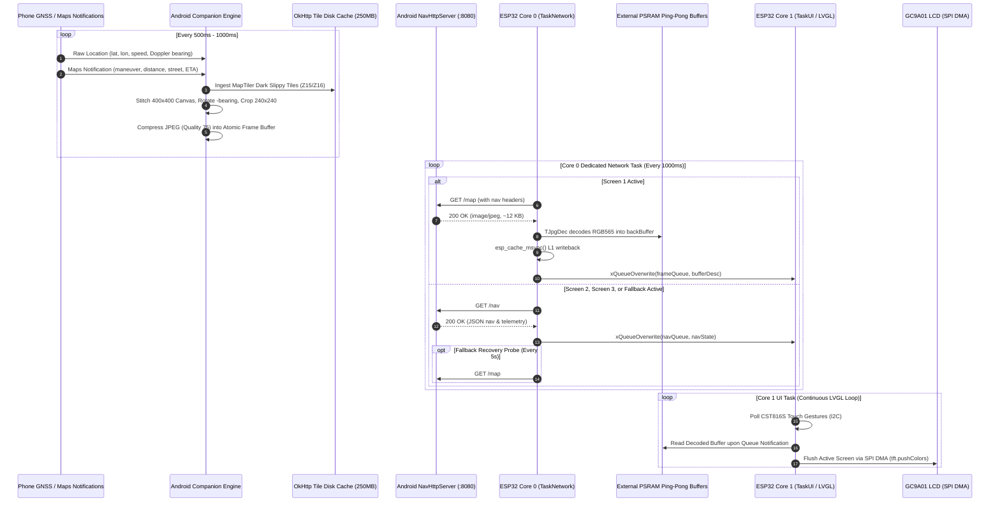
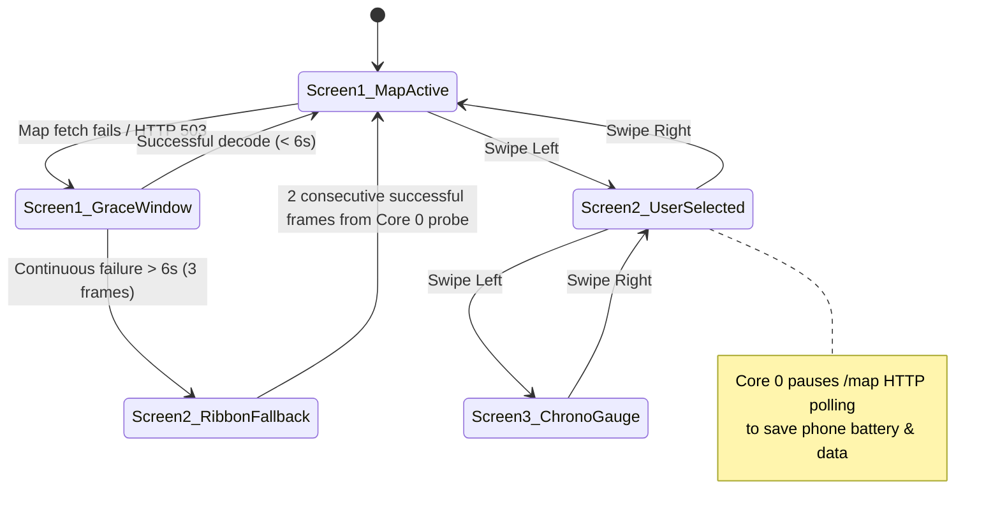

# Royal Enfield Style Full Mini-Map & Tri-Screen Dashboard (Design 2 + Multi-Screen)

*   **Author:** Bline Engineering Swarm & User
*   **Status:** Approved (Post Multi-Perspective Review & Remediation)
*   **Date:** 2026-11-15

--------------------------------------------------------------------------------

## Overview

This specification defines the architecture, data contracts, and phased implementation plan for transforming the Bline motorcycle navigation system from a single-screen monochrome ribbon into a smartwatch-style tri-screen dashboard. Operating on the Waveshare ESP32-S3-Touch-LCD-1.28 (GC9A01 240×240 circular LCD, CST816S capacitive touch, and ESP32-S3R2 with 8MB Octal-SPI PSRAM), the system allows riders to swipe horizontally between three dedicated operational displays:

1.  **Screen 1 (Mini-Map HUD — Design 2)**: Royal Enfield Tripper–style heading-up rotated raster mini-map streamed asynchronously from the companion Android app, overlaid with polar dark-scrim HUD indicators for street name, trip ETA, maneuver glyph, distance countdown, and live speed.
2.  **Screen 2 (Turn-by-Turn Vector Ribbon — Design 1)**: Beeline Moto II–style high-contrast monochrome vector navigation featuring dynamic curved maneuver ribbons, distance progress arc, and maximum direct-sunlight legibility.
3.  **Screen 3 (Classic Retro Chrono Gauge & Cockpit Telemetry)**: Classic circular analog-style speedometer with sweeping digital needle, prominent digital speed readout, cardinal compass heading ring (N, NE, E...), accumulated trip odometer, ride clock, and an upcoming turn notification banner when an active maneuver is within 150 meters.

Because the microcontroller has strict memory and compute bounds, the companion Android app executes all network tile acquisition, Web Mercator coordinate mapping, heading-up affine rotation, and JPEG compression. The ESP32 utilizes a decoupled dual-core FreeRTOS architecture: Core 0 runs a dedicated `TaskNetwork` that fetches pre-rendered $240 \times 240$ JPEGs over local Wi-Fi and decodes them via TJpgDec into external PSRAM double buffers. Core 1 runs `TaskUI`, dedicated entirely to LVGL vector compositing, CST816S touch polling, and SPI DMA display flushes without any blocking network calls. When the rider swipes away from Screen 1, the ESP32 suspends map polling, immediately preserving phone battery and radio bandwidth.

## The Problem

Motorcycle riders face distinct navigational and ergonomic challenges:
1.  **Phone Mount Hazards**: Mounting a smartphone directly to motorcycle handlebars exposes camera optical image stabilization (OIS) mechanisms to destructive high-frequency engine vibration, exposes the battery to severe solar thermal throttling, and introduces theft or detachment risks at highway speeds.
2.  **Dedicated Unit Cost & Rigidity**: Dedicated motorcycle GPS hardware (e.g., Garmin Zūmo) is expensive, bulky, and requires separate map subscriptions or complex desktop route synchronization.
3.  **The Information vs. Legibility Trade-off**:
    *   *Pure Minimalist HUDs* (e.g., Beeline Moto I) provide outstanding battery life and daylight legibility but lack spatial context when navigating confusing multi-branch intersections or roundabouts.
    *   *Full Map Displays* (e.g., smartphone map apps) provide rich spatial context but wash out under direct sunlight, overwhelm the rider with visual clutter, and drain device batteries within two hours.
4.  **Hardware & Environmental Realities**: A small 1.28-inch circular screen (32.5 mm physical diameter) mounted on a vibrating handlebar traveling at 70 km/h operates within a strict 0.5-to-1.0-second glance budget. The rider requires a system that delivers rich map context when approaching complex maneuvers, high-contrast monochrome vectors when riding under blazing midday sun, and a clean retro instrument cluster when cruising, easily switchable via motorcycle-glove swipe gestures.

## Goals

*   **Tri-Screen Swiping Carousel**: Implement a horizontal smartwatch-style carousel cycling between Screen 1 (Mini-Map HUD), Screen 2 (Vector Ribbon), and Screen 3 (Retro Chrono Gauge) via CST816S capacitive touch swipe gestures (`0x03` right, `0x04` left).
*   **Asynchronous Head-Up Mini-Map (Screen 1)**:
    *   Android pre-renders heading-up rotated $240 \times 240$ JPEG tiles from a $400 \times 400$ composite Slippy Mercator canvas using MapTiler Dark raster tiles at speed-dependent zoom levels (Z16 $\le 40\text{ km/h}$, Z15 $> 40\text{ km/h}$).
    *   ESP32 Core 0 dedicated `TaskNetwork` fetches and decodes JPEGs into external PSRAM via TJpgDec at 1.0 Hz with $< 50\text{ ms}$ decode latency.
    *   LVGL composites polar dark-scrim HUD containers for street names, maneuver countdowns, and speed without circular bezel chord clipping.
    *   Vehicle indicator anchored at the lower third ($x=120, y=160$) to maximize forward road visibility.
*   **Zero-Dependency Daylight Navigation (Screen 2)**: Retain the existing monochrome vector ribbon system with dynamic bend geometry, circular progress arc, and pure black background (`TFT_BLACK`) for direct sunlight legibility.
*   **Classic Retro Chrono Gauge (Screen 3)**:
    *   Analog-style circular speedometer dial (0–120 km/h scale) with smooth sweeping digital needle and bold numeric center readout.
    *   Cardinal compass heading ring (N, NE, E...) driven by GNSS Doppler bearing.
    *   Trip odometer (km) and elapsed ride clock.
    *   Upcoming turn banner overlay sliding into the upper display when an active navigation turn is within 150 meters.
*   **Decoupled Dual-Core FreeRTOS Architecture**:
    *   Core 0 (`TaskNetwork`): Exclusively owns HTTP networking, Wi-Fi reconnection, and TJpgDec decoding into external PSRAM.
    *   Core 1 (`TaskUI`): Pure rendering, LVGL timers, CST816S touch polling, and SPI DMA flushes. Core 1 performs zero blocking socket calls.
    *   Inter-core communication via FreeRTOS overwrite queues with explicit L1 cache writeback (`esp_cache_msync`).
*   **Context-Aware Radio Throttling**: The ESP32 suspends `/map` HTTP polling whenever Screen 1 is inactive, eliminating cellular data drain and phone CPU thermal load during extended rides on Screens 2 or 3.
*   **Vibration & Low-Speed Heading Stability**: Sourced heading strictly from raw GNSS Doppler bearing (`LocationManager.GPS_PROVIDER`). Latch bearing below 5 km/h to prevent stationary jitter, with a 10-meter rolling displacement window over 10 seconds to prevent lockups during low-speed U-turns.
*   **Debounced Fallback Hysteresis & Recovery**: If `/map` HTTP fetches fail continuously for $> 6\text{ seconds}$ while on Screen 1, automatically fail over to Screen 2. Core 0 continues background low-frequency probing (every 5s); restore Screen 1 automatically upon 2 consecutive successful frames.

## Non-Goals

*   **Forward Route Polyline Rendering**: Drawing forward route guidance lines on map tiles is excluded; Google Maps notifications do not provide route geometry, and running an independent routing engine introduces battery and routing synchronization issues.
*   **Handlebar IMU Lean Angle Fusion**: 6-axis IMU sensor fusion on the handlebars is excluded; handlebar mounting dynamics (counter-steering, low-speed steering, fork dive, and engine harmonic vibration) and physics collapse in coordinated turns ($A_y \approx 0$) make handlebar IMU roll angles invalid.
*   **Motorcycle CAN Bus Integration**: Direct hardware connection to motorcycle engine sensors (e.g., gear position sensor, physical fuel tank float) is excluded.
*   **Dynamic Speed Limit Signs**: Real-time speed limit lookup is explicitly excluded to avoid cellular latency, external API quotas, and battery drain.
*   **Multi-Touch Panning or Pinch-to-Zoom**: Map drag panning and multi-touch interactions are omitted for rider safety while moving.

## Open Questions

*   **Question 1 (Touch Sensitivity in Rain)**: Will highway rainwater droplets trigger false swipe gestures on the CST816S? (Mitigation: require minimum 60px horizontal displacement within 400ms and support a long-press screen lock mode).
*   **Question 2 (High-Ambient Contrast on Screen 1)**: Will dark-theme map tiles provide adequate visibility in direct midday sunlight? (Mitigation: Screen 2 provides an immediate 1-swipe escape to ultra-high-contrast pure monochrome vectors).

## Critical User Journeys (CUJs)

### CUJ 1: Navigating Complex City Intersections (Screen 1 Mini-Map HUD)
*   **Given**: The motorcycle is powered on, connected to the phone hotspot, navigating via Google Maps, and Screen 1 is active.
*   **When**: The rider approaches a multi-lane roundabout 150 meters away in an unfamiliar city center.
*   **Then**: The background map rotates smoothly to match vehicle heading, the vehicle arrow remains anchored at $y=160$ showing the roundabout shape ahead, the top dark scrim displays the upcoming street name, and the lower cluster counts down distance from "150 m" to "0 m" with a roundabout exit glyph.

### CUJ 2: High-Glare Highway Cruising (Swipe Transition to Screen 2)
*   **Given**: The rider is on Screen 1 but transitions onto an open desert highway under intense midday sunlight (~10,000 lux), causing map tile colors to wash out on the 400-nit panel.
*   **When**: The rider swipes left across the touch screen with their motorcycle glove.
*   **Then**: The display smoothly animates to Screen 2 (Vector Ribbon). The screen switches to a pure black background with ultra-high-contrast white road paths and large 48pt distance typography. Core 0 suspends `/map` HTTP requests, immediately preserving phone battery.

### CUJ 3: Cruising & Trip Monitoring (Swipe Transition to Screen 3 Chrono Gauge)
*   **Given**: The rider is cruising on a scenic highway without immediate turns for the next 25 kilometers.
*   **When**: The rider swipes left to Screen 3.
*   **Then**: The display presents the Classic Retro Chrono Gauge: a sweeping analog speedometer needle indicating current speed, bold digital center speed, outer cardinal compass ring, trip odometer, and ride clock. When an upcoming turn approaches within 150 meters, a compact turn banner slides into the top of the display.

### CUJ 4: Transient Tunnel & Cellular Blackout (Automated Failover & Recovery)
*   **Given**: The rider is navigating on Screen 1 and enters a 2-kilometer mountain tunnel with zero cellular signal.
*   **When**: The companion app exhausts its local 250MB tile cache and `/map` requests fail for $> 6\text{ seconds}$ (3 consecutive HTTP 503/timeout failures).
*   **Then**: The display state machine smoothly transitions the UI to Screen 2 (Vector Ribbon), preserving turn-by-turn guidance scraped from Google Maps notifications without visual flashing. Core 0 initiates background low-frequency probes every 5 seconds. Upon exiting the tunnel and receiving 2 consecutive successful map frames, the UI automatically restores Screen 1.

### CUJ 5: Low-Speed Junction & Traffic Stop (GPS Doppler Bearing Latch)
*   **Given**: The rider approaches a red traffic light at an intersection and decelerates from 50 km/h to 0 km/h.
*   **When**: Vehicle speed drops below 5 km/h.
*   **Then**: The system latches the last known valid GPS Doppler heading. As the rider comes to a complete standstill and handlebars experience engine vibration, the map orientation remains frozen, eliminating rotational spin. When the light turns green and speed exceeds 5 km/h, heading tracking resumes.

--------------------------------------------------------------------------------

## Technical Plan (Architecture)

### 1. High-Level System Architecture

The system decouples high-power mobile network compositing from low-latency embedded rendering across a local Wi-Fi link:



---

### 2. Subsystem 1: Android Companion Architecture

#### Location & Heading Processing
*   **Permissions**: `AndroidManifest.xml` declares `FOREGROUND_SERVICE_LOCATION`, `ACCESS_FINE_LOCATION`, and `ACCESS_COARSE_LOCATION`. `NavForegroundService` declares `foregroundServiceType="dataSync|location"`.
*   **Permission Gating**: `MainActivity.kt` gates starting `NavForegroundService` strictly behind user consent via `ActivityResultContracts.RequestMultiplePermissions`. In `NavForegroundService.onCreate()`, `startForeground()` passes:
    ```kotlin
    ServiceInfo.FOREGROUND_SERVICE_TYPE_DATA_SYNC or ServiceInfo.FOREGROUND_SERVICE_TYPE_LOCATION
    ```
*   **Location Sourcing**: Injected `LocationManager` configured exclusively with `LocationManager.GPS_PROVIDER` (raw GNSS hardware) to avoid magnetic distortion from motorcycle alternators.
*   **Bearing Latch Logic**:
    *   If `speed >= 5.0 km/h` and `location.hasBearing()`: update `latchedBearing = location.bearing`.
    *   If `speed < 5.0 km/h`: freeze `latchedBearing`.
    *   **Displacement Override**: If `speed < 5.0 km/h` continuously but total linear displacement over a rolling 10-second window exceeds 10 meters ($1.0\text{ m/s} = 3.6\text{ km/h} < 5.0\text{ km/h}$), calculate bearing from the start/end coordinates of the displacement window to prevent U-turn lockups.

#### Asynchronous Tile Compositor
*   **Tile Ingestion**: Standardizes on **MapTiler Dark raster tiles**:
    ```text
    https://api.maptiler.com/maps/basic-v2-dark/{z}/{x}/{y}.png?key={MAPTILER_API_KEY}
    ```
    API key is injected securely via `secrets.properties` and exposed to Kotlin through `BuildConfig.MAPTILER_API_KEY`.
*   **Dynamic Zoom Mapping**:
    *   `speed <= 40 km/h`: Zoom level 16 (high spatial detail for junctions and city navigation).
    *   `speed > 40 km/h`: Zoom level 15 (broader preview window for highway cruising).
*   **Bounding Geometry**: Anchoring the vehicle marker at $(120, 160)$ produces a maximum distance to the screen edge of $R = \sqrt{120^2 + 160^2} = 200\text{ pixels}$. An unclipped affine rotation requires an intermediate canvas of $2 \times R = 400 \times 400$ pixels. Android determines the $2 \times 2$ (or $3 \times 3$) tile grid covering this area and fetches tiles in parallel via OkHttp.
*   **Disk Cache Reuse**: Leverages native `okhttp3.Cache` instantiated at `context.cacheDir.resolve("tiles")` with a bounded 250MB size limit. Raster tiles are cached with HTTP header `Cache-Control: public, max-age=2592000` (30 days), eliminating bespoke cache index maintenance.
*   **Offscreen Transformation**:
    1.  Composite the tile grid onto a reusable $512 \times 512$ scratch `Canvas`.
    2.  Translate so the rider's coordinate is positioned at $(200, 240)$ on the $400 \times 400$ canvas.
    3.  Apply `Matrix.postRotate(-latchedBearing, 200f, 240f)`.
    4.  Crop the centered $240 \times 240$ region into a reusable `Bitmap` (anchoring rider at $x=120, y=160$).
    5.  Compress bitmap to JPEG (quality 75) into an `AtomicReference<ByteArray?>` buffer.

#### HTTP Server & Wire Protocol
*   **Concurrency**: `NavHttpServer` executes incoming socket connections using an `ExecutorService` with a fixed pool of 3 worker threads. Connections use standard HTTP request/response with `Connection: close` and `sock.soTimeout = 2000` to prevent worker thread starvation.
*   **State Store (`NavStore.kt`)**: Implements atomic partial update methods to eliminate data overwrite races:
    *   `updateLocation(speedKmh: Float, bearing: Float, tripDistM: Float, elapsedSec: Long)`
    *   `updateManeuver(navState: NavState)`
*   **Endpoint Contracts**:
    *   `GET /nav`: Responds with JSON content type:
        ```json
        {
          "nav": true,
          "maneuver": "turn-right",
          "dist_text": "250 m",
          "street": "MG Road",
          "eta": "12:34",
          "remain": "4.2 km",
          "seq": 187,
          "speed_kmh": 68.5,
          "bearing": 182.4,
          "trip_dist_km": 14.2,
          "elapsed_s": 1540,
          "map_available": true
        }
        ```
    *   `GET /map`: Responds with `Content-Type: image/jpeg` serving pre-encoded bytes directly from memory ($< 10\text{ ms}$ response latency). Injects navigation metadata into HTTP response headers (`X-Nav-Dist`, `X-Nav-Maneuver`, `X-Nav-Speed`) to keep map frames transactionally coupled with HUD telemetry. If offline and tiles miss cache, returns `503 Service Unavailable`.

---

### 3. Subsystem 2: Firmware Concurrency & Memory Architecture

```text
+--------------------------------------------------------------------------+
|                              ESP32-S3R2                                  |
|                                                                          |
|  +--------------------------------+   +-------------------------------+  |
|  |     Core 0 (TaskNetwork)       |   |       Core 1 (TaskUI)         |  |
|  |  Priority 3 | Stack: 12 KB     |   |   Priority 1 (Arduino loop)   |  |
|  |                                |   |                               |  |
|  |  1. If Screen 1: Poll GET /map |   |  1. Poll CST816S Touch (I2C)  |  |
|  |  2. If Screen 2/3: Poll /nav   |   |  2. Process LVGL Timers       |  |
|  |  3. TJpgDec decode into backBuf|   |  3. Render Active Screen      |  |
|  |  4. esp_cache_msync() flush    |   |  4. Flush via SPI DMA         |  |
|  |  5. xQueueOverwrite(frameQueue)|   |  5. ZERO Network Calls        |  |
|  +--------------------------------+   +-------------------------------+  |
|                  |                                    |                  |
|                  v                                    v                  |
|  +--------------------------------+   +-------------------------------+  |
|  |       External PSRAM (8MB OPI) |   |    Internal DMA SRAM (512KB)  |  |
|  |                                |   |                               |  |
|  |  * mapBufPing (115.2 KB RGB565)|   |  * draw_buf1 (19.2 KB DMA)    |  |
|  |  * mapBufPong (115.2 KB RGB565)|   |  * draw_buf2 (19.2 KB DMA)    |  |
|  |  * TJpgDec workspace (15 KB)   |   |  * lwIP TCP PCB stack         |  |
|  +--------------------------------+   +-------------------------------+  |
+--------------------------------------------------------------------------+
```

*   **Core 0 Task (`TaskNetwork`)**:
    *   Pinned to Core 0 with priority 3 (stack size 12 KB).
    *   Exclusively owns all Wi-Fi and HTTP socket interactions.
    *   When Screen 1 is active: polls `GET /map` at 1.0 Hz. Streams JPEG into TJpgDec, decoding big-endian RGB565 directly into the allocated PSRAM backBuffer.
    *   Calls `esp_cache_msync(backBuffer, 240 * 240 * 2, ESP_CACHE_MSYNC_FLAG_DIR_C2M)` to guarantee writeback from Core 0 L1 cache to physical PSRAM.
    *   Sends buffer index and nav headers to Core 1 via `xQueueOverwrite(frameQueue, &frameDesc)`.
    *   When Screen 2, Screen 3, or fallback is active: polls `GET /nav` at 1.0–2.0 Hz and posts `navState` to Core 1 via `navQueue`. In fallback mode, sends a probe to `/map` every 5 seconds to test recovery.
*   **Core 1 Task (`TaskUI`)**:
    *   Executes standard Arduino `setup()` and `loop()` on Core 1 at priority 1.
    *   Polls CST816S touch controller at 20 Hz to detect swipe gestures.
    *   Receives display frames and nav telemetry from FreeRTOS queues.
    *   Executes `lv_timer_handler()` and invalidates active screen widgets.
    *   Allocates LVGL draw buffers (`draw_buf1` and `draw_buf2`, 19.2 KB each) in internal DMA SRAM (`MALLOC_CAP_INTERNAL | MALLOC_CAP_DMA`). Flushes to GC9A01 via `tft.pushImageDMA()` and `tft.dmaWait()`.

---

### 4. Subsystem 3: Tri-Screen UI & Input Architecture

#### CST816S Touch Integration
*   **Bus**: I2C (SDA: GPIO 6, SCL: GPIO 7, RST: GPIO 13, INT: GPIO 5).
*   **Reset Timing**: Upon boot, pulse RST LOW for 20 ms, then HIGH for 50 ms to guarantee controller reset before I2C address `0x15` acknowledgement.
*   **Gesture Decoding**: Register `0x01` reports hardware gestures:
    *   `0x03` (Swipe Right): Decrements screen index (Screen 3 $\to$ Screen 2 $\to$ Screen 1).
    *   `0x04` (Swipe Left): Increments screen index (Screen 1 $\to$ Screen 2 $\to$ Screen 3).
*   **Screen Carousel**: Implemented via 3 dedicated screen root objects (`screenMap`, `screenRibbon`, `screenChrono`) transitioned using `lv_scr_load_anim(target, LV_SCR_LOAD_ANIM_MOVE_LEFT, 250, 0, false)`.

#### Screen Layouts

```text
     Screen 1 (Mini-Map HUD)             Screen 2 (Vector Ribbon)          Screen 3 (Retro Chrono)
     +---------------------+              +---------------------+           +---------------------+
    /     [MG Road Marquee] \            /     [MG Road Marquee] \         /       SPEED (km/h)    \
   |  (Dark Scrim, y=18-36)  |          |  (Dark Scrim, y=18-36)  |       |    0 . 20 . 40 . 60   |
  |                           |        |                           |     |   .                  . |
  |     ROTATING MAP TILE     |        |      DYNAMIC CURVED       |     |  80        72       100|
  |      BACKGROUND IMAGE     |        |       ROAD RIBBON         |     |  .    (Sweep Needle) . |
  |                           |        |                           |     |   120 .  Compass: N .  |
  |        ▲ (y=160, Cyan)    |        |        ▲ (Rider)          |     |    +---------------+   |
  |   +-------------------+   |        |   +-------------------+   |     |    | ODO: 14.2 km  |   |
   |  | -> 250m | 72 km/h |  |          |  | -> 250m | Progress|  |      |   | Time: 10:45 AM|   |
    \ +-------------------+ /            \ +-------------------+ /        \   +---------------+  /
     +---------------------+              +---------------------+          +---------------------+
```

1.  **Screen 1 (Mini-Map HUD — Design 2)**:
    *   Background: Full $240 \times 240$ `lv_img` displaying the pre-rendered rotated map tile.
    *   Vehicle Marker: Cyan-recolored position arrow (`#00DCFF`) anchored at $x=120, y=160$.
    *   Top Scrim: Dark rounded container (`LV_OPA_80`, `lv_color_black()`, radius 8) at $y=18\text{--}36$ with circular-marquee street name (14 pt bold). Hidden during active turns $< 100\text{ m}$ to reduce cognitive clutter.
    *   Bottom Scrim: Positioned at $y=165\text{--}195$ where bezel chord width is $\ge 175\text{ px}$. Displays maneuver glyph and bold distance number (36 pt).
    *   Speed Indicator: Compact centered pill at $y=210\text{--}225$ displaying live GPS speed (`72 km/h`).
2.  **Screen 2 (Turn-by-Turn Vector Ribbon — Design 1)**:
    *   Background: Solid pure black (`TFT_BLACK`, `LV_OPA_COVER`).
    *   Geometry: Dynamic 14px anti-aliased white road ribbon (`lv_line`) with 22px dark outline, positioning marker traversing stem according to distance.
    *   Progress Arc: 228px outer circular arc (`lv_arc`) indicating maneuver approach.
    *   Typography: 48 pt bold distance readout at bottom right.
3.  **Screen 3 (Classic Retro Chrono Gauge & Cockpit Telemetry)**:
    *   Gauge Dial: Circular scale from 0 to 120 km/h with tick marks every 10 km/h (`lv_meter` or `lv_arc`).
    *   Sweeping Needle: Red digital pointer smoothly indicating instantaneous GPS speed.
    *   Center Readout: Bold 44pt digital speed (`72`) with `km/h` label.
    *   Compass Heading: Circular cardinal indicator (N, NE, E, SE, S, SW, W, NW) rotating with GNSS Doppler bearing.
    *   Lower Cluster: Rounded dark badge displaying trip odometer (`ODO: 14.2 km`) and ride clock (`10:45 AM`).
    *   Turn Mini-Banner: When active distance $< 150\text{ m}$, a high-contrast navigation banner slides down over the top of the gauge displaying upcoming maneuver arrow and distance.

---

### 5. Subsystem 4: Failover State Machine & Hysteresis



*   **Grace Period**: On tile fetch failure or HTTP 503, retain the last valid map frame with an overlay offline warning icon for up to 6 seconds.
*   **Failover Threshold**: After 3 consecutive failed fetches ($> 6\text{ seconds}$), transition automatically to Screen 2 (Vector Ribbon).
*   **Recovery Probing**: In fallback mode, Core 0 executes a background probe of `GET /map` every 5 seconds.
*   **Recovery Threshold**: Require 2 consecutive successful frames on Core 0 before automatically restoring Screen 1.
*   **User Priority**: Touch swipe gestures immediately override automatic failover states.

--------------------------------------------------------------------------------

## Alternatives Considered

### Alternative A: Handlebar IMU Sensor Fusion for Roll / Lean Angle
*   **Pros**: Displays dynamic motorcycle lean angle in curves.
*   **Cons**: The display mounts to the steerable, vibrating handlebars. Counter-steering, fork dive under braking, and steering angle changes inject non-inertial errors. In coordinated turns, apparent gravity aligns with the motorcycle frame ($A_y \approx 0$), causing naive accelerometer roll to collapse to $0^\circ$. Solving this requires vehicle kinematic fusion with speed and yaw rate, adding high complexity for unproven reliability.
*   **Reason for Rejection**: Rejected in favor of the Classic Retro Chrono Gauge. Eliminates fragile IMU math, cuts driver maintenance, and delivers a robust, elegant cockpit instrument face.

### Alternative B: ESP32-Native Tile Fetching & Compositing
*   **Pros**: Android app acts purely as a notification scraper.
*   **Cons**: ESP32 lacks hardware PNG decoding. Downloading 4 PNG tiles, decoding via software, allocating $400 \times 400$ intermediate rotation canvases, and stitching within microcontroller memory drops rendering frame rates below 0.5 FPS and causes memory exhaustion.
*   **Reason for Rejection**: Insufficient microcontroller hardware resources. Offloading raster manipulation to the phone's multi-core ARM CPU and GPU graphics pipeline is fundamentally more efficient.

### Alternative C: Single-Screen Mode Only (Map with Ribbon Fallback)
*   **Pros**: Eliminates CST816S touch controller integration and multi-screen state management.
*   **Cons**: In harsh direct midday sunlight (~10,000 lux), the rider would be stuck with a washed-out map; on long cruising segments, the rider could not view clean instrument telemetry.
*   **Reason for Rejection**: Fails user requirement for multi-condition legibility and smartwatch-style swipe flexibility.

### Alternative D: Online OpenStreetMap Speed Limit Queries
*   **Pros**: Displays a real-time speed limit badge on the mini-map and dashboard screens.
*   **Cons**: Querying OpenStreetMap Overpass API or MapTiler Road Attributes over cellular for every new road link introduces 300–800ms latency, consumes external API quotas, drains phone battery, and fails completely in rural areas where OSM lacks speed limit tags.
*   **Reason for Rejection**: Explicitly rejected by owner decision to avoid battery, network, and quota fragility.

--------------------------------------------------------------------------------

## Non-Functional Requirements

### 1. Performance & Latency Budgets
*   **Map Tile Update Frequency**: 1.0 Hz (1 frame/sec) on Screen 1.
*   **End-to-End Latency**: Time from Android GPS Doppler update to GC9A01 LCD scanout must not exceed **450 ms** over local Wi-Fi:
    *   Android tile compositing & JPEG encode: $\le 60\text{ ms}$
    *   Wi-Fi socket transfer ($12\text{ KB}$): $\le 80\text{ ms}$
    *   ESP32 TJpgDec decode into PSRAM: $\le 45\text{ ms}$
    *   LVGL compositing & SPI DMA flush: $\le 25\text{ ms}$
*   **Touch Gesture Responsiveness**: CST816S swipe detection to LVGL screen animation start must be $\le 60\text{ ms}$. Screen slide animation completes within $250\text{ ms}$ at $\ge 25\text{ FPS}$.
*   **Core 1 Zero-Stall Guarantee**: Core 1 executes zero blocking socket calls, maintaining smooth 30+ FPS LVGL rendering and instant touch responsiveness.

### 2. Memory & Storage Headroom (ESP32-S3R2)
*   **Internal DMA SRAM (512 KB total, ~380 KB free heap)**:
    *   LVGL ping-pong line buffers: $240 \times 40 \times 2 \times 2 = 38.4\text{ KB}$ (DMA-capable fast RAM).
    *   lwIP TCP PCB sockets & HTTPClient stack: $\approx 45\text{ KB}$ (Core 0 only).
    *   FreeRTOS task stacks (Core 0: 12 KB, Core 1: 8 KB): $20\text{ KB}$.
    *   Remaining internal SRAM margin: $\ge 250\text{ KB}$ (healthy headroom).
*   **External PSRAM (8 MB Octal-SPI / OPI PSRAM)**:
    *   Dynamic map ping-pong framebuffers: $240 \times 240 \times 2 \times 2 = 230.4\text{ KB}$ allocated via `heap_caps_malloc(..., MALLOC_CAP_SPIRAM)`.
    *   TJpgDec scratch workspace: $15\text{ KB}$ allocated in PSRAM.
    *   Dynamic LVGL widgets & strings: $\approx 45\text{ KB}$.
    *   Total allocated PSRAM: $\approx 290\text{ KB}$ out of $8192\text{ KB}$ ($> 7.8\text{ MB}$ free PSRAM, zero runtime allocation churn).

### 3. Reliability & Resilience
*   **Watchdog Safety**: Core 0 `TaskNetwork` and Core 1 `TaskUI` independently reset the hardware task watchdog timer (`esp_task_wdt_reset()`). A Wi-Fi socket block on Core 0 cannot trigger a watchdog panic on Core 1.
*   **Failover Hysteresis**: 6-second timeout before falling back from Screen 1 to Screen 2; 2 consecutive valid frames required to restore Screen 1.

--------------------------------------------------------------------------------

## Detailed Implementation Plan

### Phased Execution Strategy

The implementation is partitioned into 4 discrete, buildable phases. Each phase leaves the project in a compiling, testable state:

```text
+-------------------------------------------------------------------------------+
| Phase 1: Android Tile Ingestion & Map Compositor Engine                       |
| [Build Checkpoint: ./gradlew assembleDebug succeeds; mock tiles verified]    |
+---------------------------------------+---------------------------------------+
                                        |
                                        v
+-------------------------------------------------------------------------------+
| Phase 2: Firmware Core 0 Dedicated Network Task & PSRAM Decoding              |
| [Build Checkpoint: bline.ino compiles; laptop stub streams tiles to GC9A01]   |
+---------------------------------------+---------------------------------------+
                                        |
                                        v
+-------------------------------------------------------------------------------+
| Phase 3: Firmware CST816S Touch Driver & Tri-Screen Carousel                  |
| [Build Checkpoint: Swipes cycle Screen 1 -> Screen 2 -> Screen 3 smoothly]   |
+---------------------------------------+---------------------------------------+
                                        |
                                        v
+-------------------------------------------------------------------------------+
| Phase 4: Integration, Failover Hysteresis & Road Verification                 |
| [Build Checkpoint: 6s failover and auto-recovery verified on test motorcycle] |
+-------------------------------------------------------------------------------+
```

---

### Phase 1: Android Tile Ingestion & Map Compositor Engine

#### 1. `android/app/build.gradle.kts` (Modify)
*   **Target Scope**: Android Module Build Configuration
*   **Actionable Steps**:
    *   Add OkHttp dependency to `dependencies {}`:
        ```kotlin
        implementation("com.squareup.okhttp3:okhttp:4.12.0")
        ```
    *   Expose `MAPTILER_API_KEY` via `buildConfigField` from local `secrets.properties`.

#### 2. `android/app/src/main/AndroidManifest.xml` (Modify)
*   **Target Scope**: Application Manifest
*   **Actionable Steps**:
    *   Add permissions:
        ```xml
        <uses-permission android:name="android.permission.ACCESS_FINE_LOCATION" />
        <uses-permission android:name="android.permission.ACCESS_COARSE_LOCATION" />
        <uses-permission android:name="android.permission.FOREGROUND_SERVICE_LOCATION" />
        ```
    *   Update `<service android:name=".NavForegroundService">` attribute:
        ```xml
        android:foregroundServiceType="dataSync|location"
        ```

#### 3. `android/app/src/main/java/com/bline/nav/NavState.kt` (Modify)
*   **Target Scope**: Kotlin Data Model
*   **Actionable Steps**:
    *   Add telemetry fields:
        ```kotlin
        val speedKmh: Float = 0f,
        val bearing: Float = 0f,
        val tripDistKm: Float = 0f,
        val elapsedS: Long = 0L,
        val mapAvailable: Boolean = false
        ```
    *   Update `toJson()` serializer to include new keys with backward compatibility.

#### 4. `android/app/src/main/java/com/bline/nav/NavStore.kt` (Modify)
*   **Target Scope**: Thread-Safe State Store
*   **Actionable Steps**:
    *   Implement atomic partial update methods to prevent telemetry from overwriting maneuver notifications:
        ```kotlin
        fun updateLocation(speedKmh: Float, bearing: Float, tripDistKm: Float, elapsedS: Long)
        fun updateManeuver(maneuver: String, distText: String, street: String, eta: String, remain: String)
        ```

#### 5. `android/app/src/main/java/com/bline/nav/MainActivity.kt` (Modify)
*   **Target Scope**: Android User Interface Activity
*   **Actionable Steps**:
    *   Inject `ActivityResultContracts.RequestMultiplePermissions` requesting `ACCESS_FINE_LOCATION` and `ACCESS_COARSE_LOCATION` alongside `POST_NOTIFICATIONS`.
    *   Gate `NavForegroundService.start(this)` behind the granted permission callback.
    *   Display live telemetry on UI: current speed, bearing, cache status, and service state.

#### 6. `android/app/src/main/java/com/bline/nav/MapTileCompositor.kt` (Create)
*   **Target Scope**: Offscreen Graphics & Tile Worker
*   **Actionable Steps**:
    *   Configure OkHttp with bounded 250MB `Cache(File(context.cacheDir, "tiles"), 250L * 1024 * 1024)`.
    *   Fetch MapTiler Dark raster tiles at speed-dependent zoom (Z16 $\le 40\text{ km/h}$, Z15 $> 40\text{ km/h}$).
    *   Stitch $2 \times 2$ (or $3 \times 3$) tile grid onto reusable $512 \times 512$ scratch bitmap.
    *   Translate rider position to $(200, 240)$ on $400 \times 400$ canvas, apply `Matrix.postRotate(-latchedBearing, 200f, 240f)`, and crop centered $240 \times 240$ bitmap.
    *   Compress to JPEG (quality 75) into an `AtomicReference<ByteArray?>`.

#### 7. `android/app/src/main/java/com/bline/nav/NavForegroundService.kt` (Modify)
*   **Target Scope**: Background Service Component
*   **Actionable Steps**:
    *   In `onCreate()`, update `startForeground()` call:
        ```kotlin
        val serviceType = if (Build.VERSION.SDK_INT >= 34) {
            ServiceInfo.FOREGROUND_SERVICE_TYPE_DATA_SYNC or ServiceInfo.FOREGROUND_SERVICE_TYPE_LOCATION
        } else 0
        startForeground(NOTIF_ID, notification, serviceType)
        ```
    *   Initialize `LocationManager.requestLocationUpdates(LocationManager.GPS_PROVIDER, 1000L, 0f, locationListener)`.
    *   Implement Doppler bearing latch: latch when `speed >= 5 km/h`; freeze when `speed < 5 km/h`; unlatch if 10m displacement occurs over 10 seconds.
    *   Forward updates to `MapTileCompositor` and `NavStore`.

#### 8. `android/app/src/main/java/com/bline/nav/NavHttpServer.kt` (Modify)
*   **Target Scope**: Embedded Socket Server
*   **Actionable Steps**:
    *   Refactor to `Executors.newFixedThreadPool(3)` with `sock.soTimeout = 2000`.
    *   Add binary route `GET /map`: serve pre-encoded JPEG bytes with `Content-Type: image/jpeg` and nav metadata headers (`X-Nav-Dist`, `X-Nav-Maneuver`, `X-Nav-Speed`). If no frame available, return `503 Service Unavailable`.
    *   Use `Connection: close` to prevent socket starvation across clients.

*Phase 1 Checkpoint*: Run `./gradlew assembleDebug`. Confirm compilation passes with zero errors and test location updates on Android device.

---

### Phase 2: Firmware Core 0 Dedicated Network Task & PSRAM Decoding

#### 9. `bline.ino` (Modify — Part 1: Networking & Memory)
*   **Target Scope**: Firmware Core 0 Architecture & PSRAM Double Buffering
*   **Actionable Steps**:
    *   Verify PSRAM configuration: `PSRAM: OPI PSRAM` at 80 MHz.
    *   Dynamically allocate ping-pong buffers in external PSRAM:
        ```cpp
        mapBufPing = (uint16_t *)heap_caps_malloc(240 * 240 * 2, MALLOC_CAP_SPIRAM);
        mapBufPong = (uint16_t *)heap_caps_malloc(240 * 240 * 2, MALLOC_CAP_SPIRAM);
        tjpgdWorkspace = (void *)heap_caps_malloc(15 * 1024, MALLOC_CAP_SPIRAM);
        ```
    *   Create FreeRTOS overwrite queues: `frameQueue = xQueueCreate(1, sizeof(FrameDesc))` and `navQueue = xQueueCreate(1, sizeof(NavSnapshot))`.
    *   Implement `TaskNetwork` pinned to Core 0 (Priority 3, stack 12 KB):
        *   When Screen 1 is active: fetch `GET /map` via `HTTPClient` (timeout 1200ms).
        *   Decode stream directly into backBuffer via TJpgDec with big-endian format.
        *   Flush L1 cache to physical PSRAM via `esp_cache_msync()`.
        *   Post buffer descriptor to `frameQueue`.
        *   When Screen 2/3 active or fallback: poll `GET /nav` at 1.0–2.0 Hz and post to `navQueue`.
    *   Update `applyNavJson()` to deserialize `speed_kmh`, `bearing`, `trip_dist_km`, and `elapsed_s`.

*Phase 2 Checkpoint*: Run `python3 tools/nav_stub.py --demo` and verify that the ESP32 decodes and displays rotating synthetic test map tiles on the GC9A01 LCD without Core 1 UI stalls.

---

### Phase 3: Firmware CST816S Touch Driver & Tri-Screen Carousel

#### 10. `cst816s.h` & `cst816s.cpp` (Create)
*   **Target Scope**: Embedded C++ Hardware Driver
*   **Actionable Steps**:
    *   Define `class CST816S` on SDA GPIO 6, SCL GPIO 7, RST GPIO 13, INT GPIO 5.
    *   Implement `bool begin()` with mandatory hardware reset pulse:
        ```cpp
        pinMode(RST_PIN, OUTPUT);
        digitalWrite(RST_PIN, LOW);
        delay(20);
        digitalWrite(RST_PIN, HIGH);
        delay(50);
        Wire.begin(SDA_PIN, SCL_PIN, 400000);
        ```
    *   Implement `bool readTouch(uint8_t &gesture, uint16_t &x, uint16_t &y)` reading register `0x01` (`0x03` = Swipe Right, `0x04` = Swipe Left).

#### 11. `bline.ino` (Modify — Part 2: Tri-Screen UI & Gestures)
*   **Target Scope**: LVGL Screen Hierarchy & Touch Navigation
*   **Actionable Steps**:
    *   Connect CST816S touch driver to LVGL input device driver (`lv_indev_drv_t`).
    *   Construct Screen 1 (Mini-Map HUD): `lv_img` background, cyan marker at $(120, 160)$, top dark street container, bottom maneuver/distance container at $y=165\text{--}195$, and centered speed pill at $y=210\text{--}225$.
    *   Construct Screen 2 (Turn-by-Turn Vector Ribbon): Preserve high-contrast monochrome vector road ribbon with dynamic bend geometry and 228px circular progress arc.
    *   Construct Screen 3 (Classic Retro Chrono Gauge): Analog-style speedometer dial (0–120 km/h) with sweeping red digital pointer, center digital speed, cardinal compass ring (N, NE, E...), trip odometer, and upcoming turn mini-banner ($< 150\text{ m}$).
    *   Handle swipe gestures to animate transitions between Screen 1 $\longleftrightarrow$ Screen 2 $\longleftrightarrow$ Screen 3.

*Phase 3 Checkpoint*: Verify that horizontal swipe gestures cycle smoothly between all three screens on the physical Waveshare hardware.

---

### Phase 4: Integration, Failover Hysteresis & Road Verification

#### 12. `tools/nav_stub.py` (Modify)
*   **Target Scope**: Python Simulation Tooling
*   **Actionable Steps**:
    *   Add `--fail-map` flag to simulate cellular dropouts and HTTP 503 errors.
    *   Validate that Screen 1 retains the last map frame for 6 seconds, transitions automatically to Screen 2, and automatically restores Screen 1 when `--fail-map` is cleared and 2 valid frames arrive.

#### 13. `SETUP.md` (Modify)
*   **Target Scope**: Project Documentation
*   **Actionable Steps**:
    *   Document CST816S touch pinouts (SDA 6, SCL 7, RST 13, INT 5).
    *   Specify Arduino IDE settings: Board `ESP32S3 Dev Module`, PSRAM `OPI PSRAM`, Flash `8MB`.
    *   Document TJpgDec library dependency.

*Phase 4 Checkpoint*: Execute bench integration test with simulated phone server and road test on motorcycle handlebars.

---

### Verification Plan

#### 1. Compilation & Static Analysis
*   **Firmware Build**: Compile `bline.ino` with Arduino CLI targeting `esp32s3` with `PSRAM=opi`. Verify zero compiler warnings and confirm internal SRAM BSS/data usage remains $< 150\text{ KB}$.
*   **Android Build**: Run `./gradlew assembleDebug` and `./gradlew lint`. Verify zero errors and confirm targetSdk 35 compliance.

#### 2. Unit & Component Verification
*   **Android Location Latch Test**: Unit-test `NavForegroundService` bearing filter:
    *   Assert bearing updates when speed $\ge 5\text{ km/h}$.
    *   Assert bearing remains latched when speed drops to $0\text{ km/h}$.
    *   Assert bearing updates if 10m displacement occurs over 10 seconds under $5\text{ km/h}$.
*   **Android Tile Compositor Test**: Verify that $400 \times 400$ canvas crop outputs valid $240 \times 240$ JPEG images with valid `0xFFD8` headers.
*   **ESP32 TJpgDec Output Verification**: Verify big-endian RGB565 pixel decoding into PSRAM buffers without color inversion on GC9A01 LCD.

#### 3. Integration & Hardware-in-the-Loop Testing
*   **Laptop Stub Verification**: Run `python3 tools/nav_stub.py --demo` and connect ESP32:
    *   Verify Screen 1 renders rotating test map tiles at 1.0 Hz with no LVGL stutter.
    *   Verify horizontal swipe gestures cycle between Screen 1 $\longleftrightarrow$ Screen 2 $\longleftrightarrow$ Screen 3.
    *   Verify that while on Screen 2 or 3, HTTP access log confirms `/map` requests are completely suspended.
*   **Failover & Hysteresis Test**: Run `tools/nav_stub.py --fail-map`:
    *   Verify Screen 1 retains the last map frame with an offline indicator for 6 seconds.
    *   Verify Screen 1 automatically transitions to Screen 2 after 6 seconds.
    *   Clear `--fail-map` and verify Screen 1 restores cleanly after 2 consecutive successful frames from Core 0 background probe.

#### 4. Environmental & Road Testing
*   **Daylight Washout & Legibility**: Ride under direct midday sunlight (~10,000 lux) and verify readability of Screen 1 dark scrims vs. Screen 2 high-contrast vectors.
*   **Handlebar Vibration at 70 km/h**: Mount ESP32 to motorcycle handlebar, ride at 70 km/h:
    *   Verify GPS Doppler bearing remains stable with zero rotational jitter.
    *   Verify CST816S touch controller does not trigger false screen swipes from wind or road shock.
    *   Verify Screen 3 Retro Chrono needle and cardinal compass update smoothly.

--------------------------------------------------------------------------------

*Drafted & Approved with EGM*
